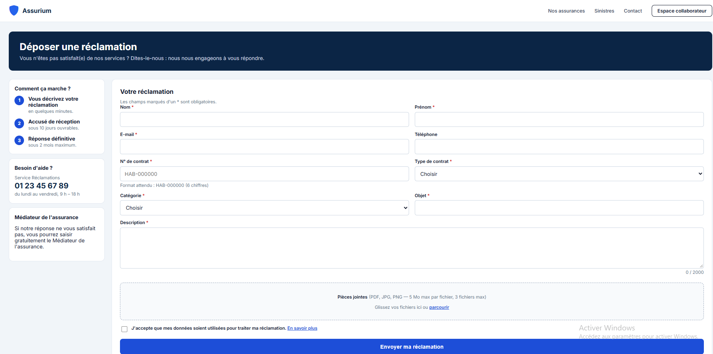
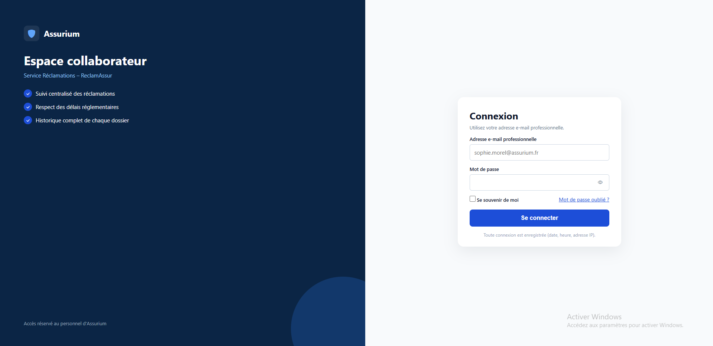
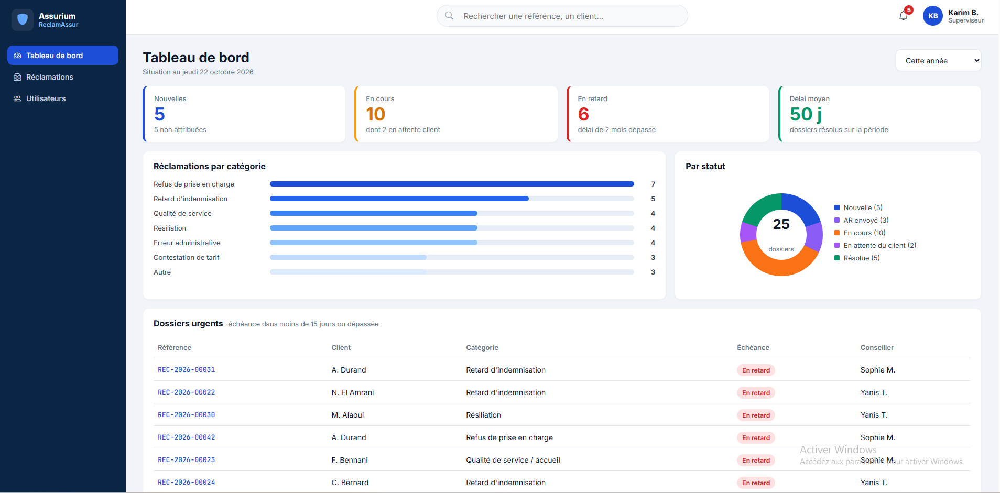
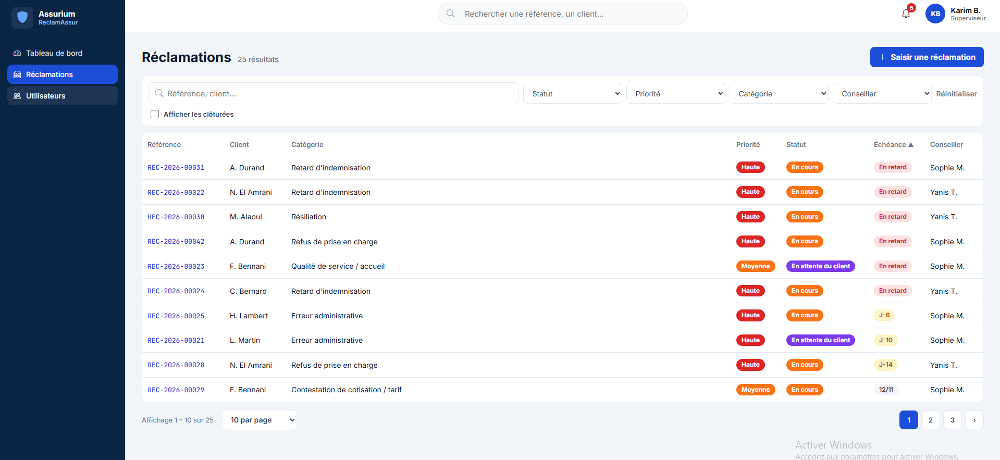
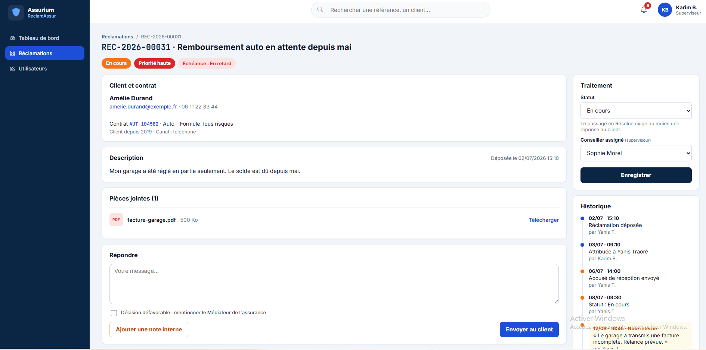

# ReclamAssur

Application web de gestion des réclamations clients pour la compagnie fictive Assurium.

Un client dépose une réclamation. Un superviseur l'attribue à un conseiller. Le conseiller répond, change le statut, puis clôture le dossier. Les délais, les priorités, l'historique et les pièces jointes suivent le cahier des charges.

## Technologies

HTML, CSS, Bootstrap 5, JavaScript, PHP 8, MySQL .

## Installation pas à pas (Laragon)

1. Copier le dossier du projet dans `C:\laragon\www\htdocs\reclamassur`.
2. Démarrer Apache et MySQL dans Laragon.
3. Créer la base `reclamassur` (encodage `utf8mb4`).
4. Importer le fichier `database.sql` dans cette base. Il crée les tables et les données de test.
5. Copier `.env.example` vers `.env`.
6. Vérifier que `.env` contient :

```env
DB_HOST=127.0.0.1
DB_PORT=3306
DB_NAME=reclamassur
DB_USER=root
DB_PASS=
BASE_PATH=/htdocs/reclamassur/public
```

7. Ouvrir `http://localhost/htdocs/reclamassur/public/reclamation.php`.

Le dossier visible par le navigateur est `public`. Les pièces jointes restent dans `uploads`, hors de `public`.

## Comptes de test

| Nom          | E-mail                   | Mot de passe     | Rôle        |
|---|---|---|--|
| Karim Benali | karim.benali@assurium.fr | Superviseur2026! | Superviseur |
| Sophie Morel | sophie.morel@assurium.fr | Conseiller2026!  | Conseiller  |
| Yanis Traoré | yanis.traore@assurium.fr | Conseiller2026!  | Conseiller  |

Dépôt public de test : Amélie Durand, `amelie.durand@exemple.fr`, contrat `AUT-104582`.

## Captures d'écran

Page 1, dépôt public :



Page 2, connexion :



Page 3, tableau de bord :



Page 4, liste des réclamations :



Page 5, détail d'une réclamation :



## Version en ligne

Le site est en ligne sur InfinityFree :

https://reclamassur.infinityfreeapp.com/public/reclamation.php

## Organisation


reclamassur/
├── public/                 pages du site
├── src/                    code PHP
├── uploads/                pièces jointes, hors du dossier public
├── database.sql            tables et données de test
├── .env.example            modèle de configuration
└── README.md